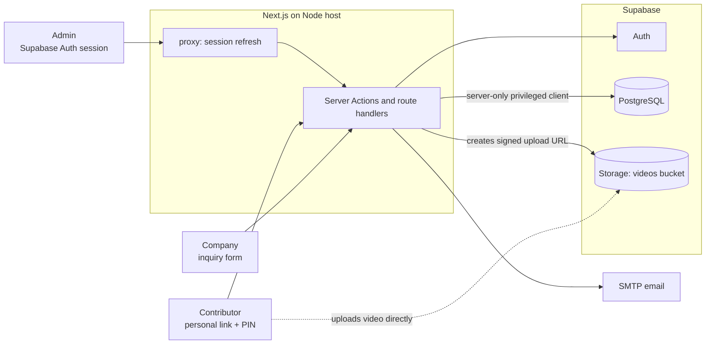
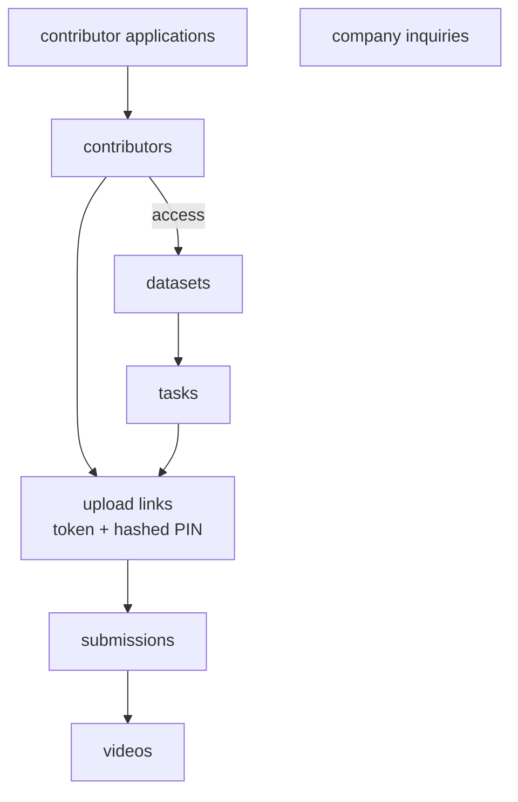
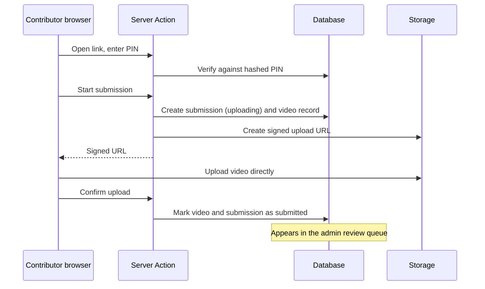

# Autosnabb Platform: showcase

A web platform for collecting first-person video demonstrations of car-interior cleaning, as training data for embodied AI and Vision-Language-Action (VLA) robotics research.

> **This is a showcase repository.** It describes the product, its architecture and my role in it. The application source code is private and is intentionally not published here. For the company-level vision, see [Autosnabb](https://github.com/Hiirihii/autosnabb).

| | |
| --- | --- |
| **Status** | Working internal MVP. Started July 2026; about 40 commits |
| **Domain** | Robotics / AI training-data collection |
| **Stack** | Next.js 16, React 19, TypeScript, Tailwind CSS 4, Supabase (PostgreSQL, Auth, Storage), Nodemailer |
| **My role** | Product owner and designer; directed AI-assisted implementation (see [How this was built](#how-this-was-built)) |

## The problem

Robot-learning models need large amounts of high-quality demonstration data from real environments, and physical interaction data is much harder to get than text or images. Car-interior cleaning is a demanding example because every vehicle is different. Collecting that data needs a workflow with several parties:

- people who actually do the cleaning and can record it,
- a team that defines tasks, checks quality and controls who can access what,
- companies who might want the data.

Large video files, consent and controlled access make a spreadsheet-and-email process unworkable.

## The solution

A single platform with three audiences:

- **Contributors** (cleaners) apply, receive access to specific tasks and upload first-person videos through personal links.
- **Admins** (the Autosnabb team) manage datasets, tasks and contributors, and review every submission.
- **Companies** (robotics/AI) get an inquiry channel.

## Key features

**Public site**
- Landing page explaining the data offering
- Contributor application form with consent handling
- Company inquiry form

**Admin area (login required)**
- Datasets: create, edit, publish and archive
- Tasks within datasets, with instructions and reward
- Contributor management and per-dataset / per-task access control
- Personal, PIN-protected upload links per contributor and task
- Submission review: list, detail view with video, approve or reject
- Email notifications for applications, inquiries and access grants

**Contributor area**
- Token-based pages (no account) listing the tasks the contributor may work on
- Upload page with PIN verification and direct-to-storage video upload

## Architecture

The Next.js App Router application uses Server Actions and route handlers. Supabase provides the database, admin authentication and video storage. There is no separate backend.

### Core entities

### Video upload flow

## Interesting technical decisions

- **Account-free contributors.** Contributors use unguessable personal links plus a PIN instead of accounts, which lowers friction for people who may only record a few videos.
- **PINs are hashed** (bcrypt), never stored in plain text.
- **Direct-to-storage uploads with signed URLs.** Large videos do not pass through the application server, which avoids body-size limits and server cost.
- **Privileged database access is server-only.** The key that bypasses row-level security is used only in server code and is never sent to the browser.
- **Explicit workflow states** for submissions (uploading, submitted, approved, rejected) and for datasets (draft, published, archived).
- **Access is granular:** a contributor sees only the datasets and tasks they were explicitly granted.

## Current state and roadmap

**Working today:** the whole loop from application to access, upload and review, including admin tooling and email notifications.

**Honest gaps and next steps**
- No automated test suite yet
- Database schema and access policies are managed directly in Supabase and are not yet version-controlled as migrations in the repository
- Authorization currently relies on server-side checks with a privileged client; adding row-level-security policies as defence in depth is a natural next step
- Video-quality tooling (automatic checks, previews, metadata validation) and dataset export
- Contributor payouts and reward tracking
- Broader hardening and review before opening to a larger contributor group

## How this was built

I designed the product and directed its development; the source code is largely **written by AI coding agents** (Claude Code) working under my direction. I do not claim to have hand-written most of the code.

My contribution:
- **Defining the product:** translating a research-data need (first-person demonstrations for robotics) into a concrete workflow with three parties, consent, access control and review.
- **Key design choices:** token and PIN based contributor access, signed direct uploads, the dataset → task → submission structure.
- **Working method:** building in small vertical increments (dataset management → tasks → review → upload → contributor access → email), reviewing and testing each, and keeping agent instructions in the repository.
- **Product ownership:** deciding priorities, scope and what the platform should and should not do.

## Contact

[github.com/Hiirihii](https://github.com/Hiirihii)

*This repository contains documentation only. Source code and data are not licensed for reuse.*
